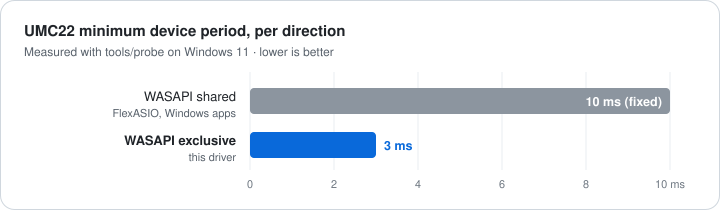
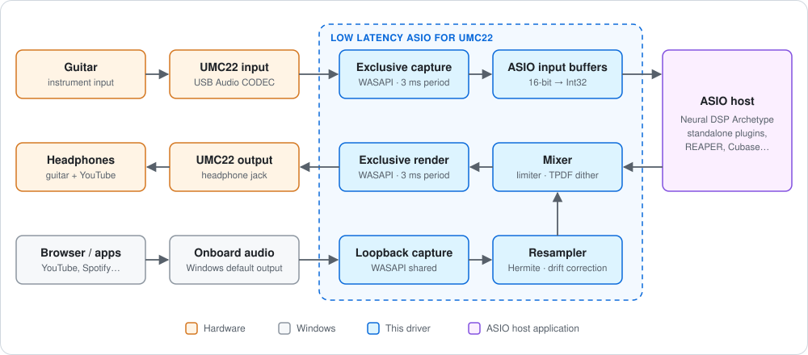

<div align="center">

# Low Latency ASIO for UMC22

**A low-latency ASIO driver for the Behringer UMC22 that keeps the rest of Windows audible.**<br>
Play through Neural DSP Archetype plugins or your DAW at 3 ms while YouTube plays in the same headphones.

[](https://github.com/Tohzzicklao/umc22-asio/releases/latest)
[](LICENSE)


[**Download**](https://github.com/Tohzzicklao/umc22-asio/releases/latest) · [Install](#installation) · [How it works](#how-it-works) · [Configuration](#configuration) · [Troubleshooting](#troubleshooting)

</div>

---

## Overview

The Behringer UMC22 (USB Audio CODEC / PCM2902) has **no official ASIO driver**. The usual workarounds force a trade-off:

| Option | Latency | Other apps (YouTube…) |
|---|---|---|
| FlexASIO / WASAPI shared mode | High: the UMC22 has a **fixed 10 ms period** in shared mode | ✅ Audible |
| ASIO4ALL / exclusive mode | Low | ❌ Silent: the device is locked |
| **Low Latency ASIO for UMC22** | **Low: 3 ms period** in exclusive mode | ✅ **Mixed into the headphones by the driver** |

<p align="center">
  
</p>

## Features

- **WASAPI exclusive input and output** at the device's minimum period (144 frames @ 48 kHz = 3 ms), event-driven, with MMCSS "Pro Audio" scheduling.
- **Windows audio mixing**: browser, music players and system sounds are captured via WASAPI loopback and mixed into the headphone output.
- **Automatic output switching**: the Windows default output is moved off the UMC22 while the driver is open and restored when it closes.
- **Clean summing**: cubic Hermite resampler with smoothed clock-drift correction, click-free fades, a −0.2 dBFS peak limiter and TPDF dither to 16-bit.
- **Mono guitar fix**: if the host only sends the left channel, it's copied to the right automatically.
- **No Steinberg SDK required**, and no runtime dependencies (statically linked DLL).
- Plain-text configuration, rotating log file and an optional level/phase meter for diagnostics.

## Compatibility

### Host applications

The driver is a standard ASIO driver, so it works with any application that supports ASIO.

| Host | Status |
|---|---|
| Neural DSP **Archetype: Nolly X** (standalone) | ✅ Tested |
| Other Neural DSP standalone plugins (Archetype series, etc.) | Expected to work: same ASIO host framework |
| DAWs with ASIO support (REAPER, Cubase, Ableton Live, FL Studio, Studio One…) | Expected to work |
| Other standalone amp sims and ASIO applications | Expected to work |

> Only **one ASIO application at a time** can use the driver, because the UMC22 is opened in exclusive mode. Close one host before opening another.

### Audio interfaces

| Device | Status |
|---|---|
| Behringer **UMC22** | ✅ Tested |
| Other USB Audio Class 1.0 interfaces with a stereo in/out | May work: set the device names in [`config.ini`](#configuration) |

### System

Windows 10 or 11, x64. A second Windows output device is used as the source for the Windows audio mix. The motherboard's onboard audio works, and nothing needs to be plugged into it.

## Installation

1. Download `umc22-asio-vX.Y.Z-win64.zip` from the [latest release](https://github.com/Tohzzicklao/umc22-asio/releases/latest).
2. Extract it to a **permanent** folder (the driver is registered from that location).
3. Close any ASIO application.
4. Run **`install.bat`** and accept the administrator prompt.

To uninstall, run `install.bat /u`.

## Quick start

1. Open your host, e.g. a Neural DSP Archetype plugin: **Settings → Audio**.
2. Driver type **ASIO**, device **"Low Latency ASIO for UMC22"**.
3. Sample rate **48000 Hz**, buffer size **144**.
4. Select the input channel your guitar is plugged into (**UMC22 In 1** or **In 2**) and outputs **UMC22 Out L / R**.
5. Play something on YouTube: it comes through the same headphones.

## How it works

<p align="center">
  
</p>

1. **Guitar path.** The UMC22 input is opened in WASAPI exclusive mode. Each capture packet is converted to 32-bit and delivered to the host through the ASIO double buffers. Packets are de-duplicated by device position so the host always sees a continuous stream.
2. **Host processing.** The host (e.g. Archetype: Nolly X) processes the block and returns the output buffer.
3. **Windows audio.** While the driver is running, Windows plays to another device (by default the onboard "High Definition Audio Device"). The driver records that device through WASAPI loopback, resamples it to the driver's sample rate and compensates for the clock drift between both devices.
4. **Mix and output.** Guitar and Windows audio are summed, passed through a peak limiter, dithered to 16-bit and written to the UMC22 output in exclusive mode.

**Typical latency** reported to the host at 48 kHz with a 144-sample buffer: **3.0 ms input / 6.0 ms output**, not counting USB and converter latency.

## Configuration

`%APPDATA%\UMC22ASIO\config.ini` is created on first use. Open it with the **Control Panel** button in your host's ASIO settings. Changes apply the next time the host opens the driver.

| Key | Default | Description |
|---|---|---|
| `render` / `capture` | `USB Audio CODEC` | Substring of the output / input device name |
| `loopback` | `High Definition Audio Device` | Device whose audio is mixed into the headphones (empty = disabled) |
| `ytVolume` | `1.0` | Volume of the Windows audio mix (0–2) |
| `ytLatencyMs` | `40` | Buffer for the Windows audio; raise it if it drops out |
| `preferredBuffer` | `144` | Preferred ASIO buffer size (frames) |
| `monoAuto` | `1` | Copy L→R if the host only sends the left channel |
| `autoDefault` | `1` | Automatically switch/restore the Windows default output |
| `debugMeter` | `0` | Log levels, phase correlation and limiter activity every 5 s |

Log file: `%APPDATA%\UMC22ASIO\log.txt` (rotated to `log.old.txt` above 512 KB).

## Troubleshooting

| Symptom | Cause / fix |
|---|---|
| "The UMC22 is in use by another app" | An app has the UMC22 open and doesn't follow the default device. Change its output in *Settings → Sound → Volume mixer* |
| "Exclusive mode is disabled in the UMC22 properties" | *Sound settings → UMC22 → More sound settings → Advanced* → enable "Allow applications to take exclusive control" |
| "UMC22 (USB Audio CODEC) not found" | Interface unplugged, or a different device name: adjust `render` / `capture` in `config.ini` |
| No YouTube / Windows audio | Make sure apps play to the `loopback` device and that `log.txt` shows `loopback active` |
| Windows audio sounds hollow or vocals are weak | Disable *Audio enhancements* and *Spatial sound* on the loopback device. If it also happens without the driver, check the headphone plug: a TRRS headset plug in a TRS jack, or a half-inserted plug, cancels everything panned to the centre |
| Windows audio drops out | Raise `ytLatencyMs` to 60–80 |
| Guitar crackles | Increase the buffer size in your host (192, 256) |

## Building from source

Requires Visual Studio 2022 or later with **Desktop development with C++**.

```bat
git clone https://github.com/Tohzzicklao/umc22-asio.git
cd umc22-asio
build.bat          :: builds umc22asio.dll and tools\bin\*.exe
install.bat        :: copies to bin\ and registers the driver (admin)
```

`build.bat` locates Visual Studio automatically through `vswhere`.

> **Updating while a host is open:** Windows allows renaming a loaded DLL. Rename `bin\umc22asio.dll`, copy the new build in, and the host picks it up on its next start. The registered path doesn't change.

### Releasing

```bat
build.bat
package.bat 1.2.0  :: creates dist\umc22-asio-v1.2.0-win64.zip
gh release create v1.2.0 dist\umc22-asio-v1.2.0-win64.zip --title "v1.2.0" --notes-file CHANGELOG.md
```

### Project layout

```
umc22asio.cpp     Driver: ASIO interface, WASAPI engine, mixer, COM registration
umc22asio.def     DLL exports
build.bat         Builds the driver and the tools (MSVC x64)
install.bat       Registers / unregisters the driver
package.bat       Creates the release zip
docs/             Diagrams used in this README
tools/            Diagnostic utilities (see below)
```

### Diagnostic tools

| Tool | Purpose |
|---|---|
| `probe` | Lists audio devices with their mix format, shared/exclusive periods and supported exclusive formats |
| `testhost` | Minimal ASIO host: loads `umc22asio.dll` without registering it and counts callbacks for 3 s (`testhost.exe [buffer]`, run from the folder that contains the DLL) |
| `phasetest` | Plays a mono test tone on the loopback device and measures L/R level and phase with synchronous detection, to find Windows effects that alter the stereo image. Set the endpoint ID at the top of the file |

## Limitations

- 44.1 / 48 kHz only, 2 inputs / 2 outputs.
- The UMC22 only accepts 16-bit samples in exclusive mode.
- The onboard output also plays the Windows audio (only audible if something is plugged into it).
- `IPolicyConfig`, used to switch the default device, is an undocumented Windows interface.

## ASIO SDK

This project **does not include, use, or require the Steinberg ASIO SDK**. No SDK source files or headers are part of this repository, and none are needed to build it.

An ASIO driver is an in-process COM object that a host loads and calls through a fixed binary interface: a table of virtual methods plus a few plain C structs. `umc22asio.cpp` declares that interface itself (the method order, calling convention and struct layouts needed for binary compatibility with ASIO hosts) and implements it with original code on top of Windows WASAPI. This is done purely for interoperability, so that existing ASIO hosts can talk to the driver.

For context: Steinberg historically distributed the ASIO SDK under a proprietary license that does not allow redistributing its files, which is why other open-source drivers download it at build time. Since October 2025 Steinberg also offers the ASIO SDK under the GPLv3, so a future version of this project could adopt the official headers without any licensing conflict, as this project is GPLv3 as well.

## License

Copyright © 2026 Tohzzicklao

This program is free software: you can redistribute it and/or modify it under the terms of the **GNU General Public License v3.0** or (at your option) any later version. It is distributed in the hope that it will be useful, but **without any warranty**. See [`LICENSE`](LICENSE) for the full text.

## Trademarks and disclaimer

This is an independent, unofficial project. It is **not affiliated with, endorsed by, or supported by** Steinberg Media Technologies GmbH, Behringer / Music Tribe, or Neural DSP Technologies.

- ASIO is a trademark and software of Steinberg Media Technologies GmbH.
- Behringer and UMC22 are trademarks of Music Tribe Global Brands Ltd.
- Archetype and Archetype: Nolly X are products of Neural DSP Technologies.
- All other trademarks belong to their respective owners and are used only to describe compatibility.

Use at your own risk. Keep your monitoring volume at a safe level, especially when testing a new configuration.
